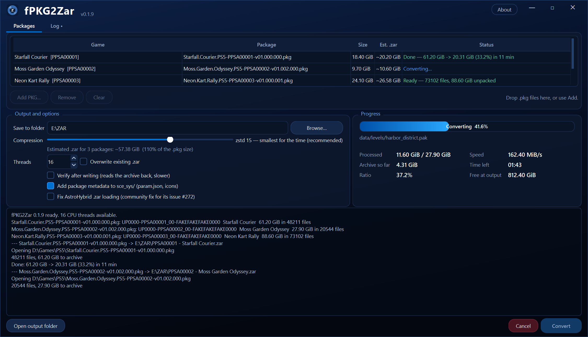
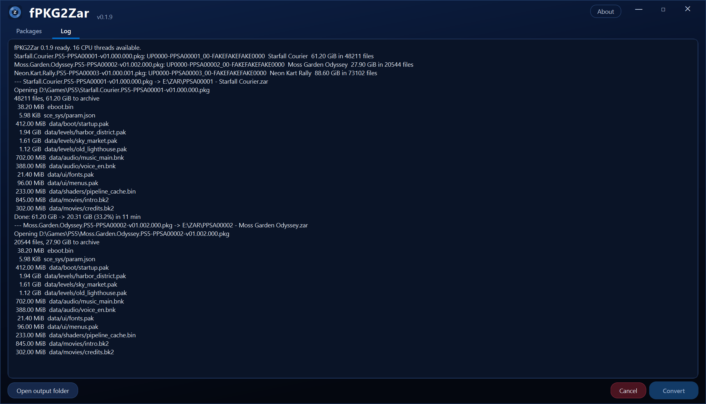
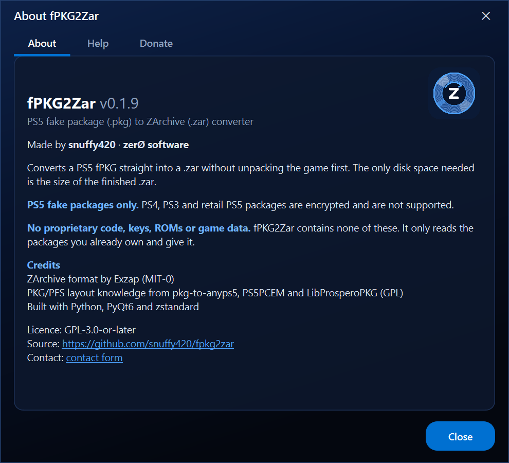
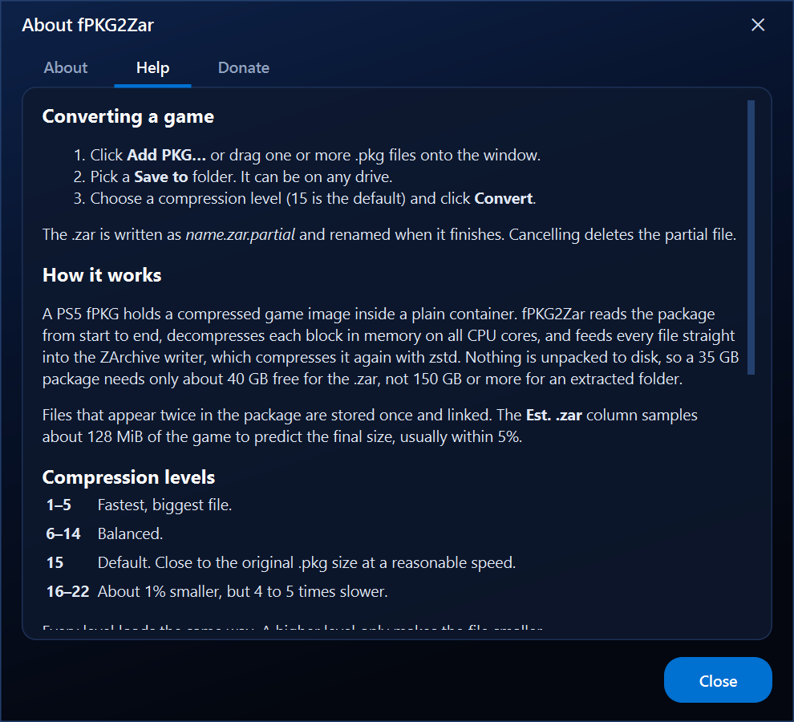
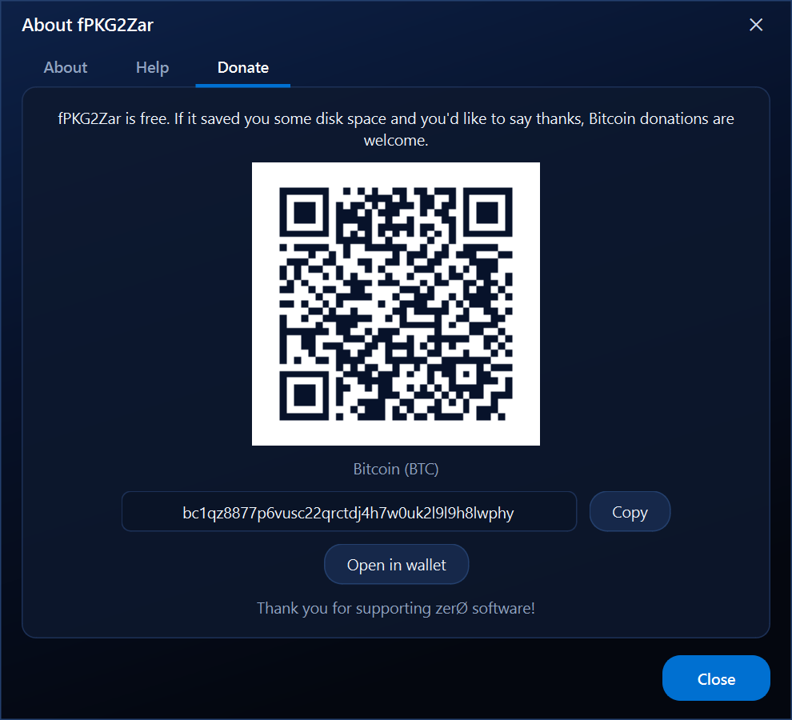

<p align="center"></p>
<h1 align="center">fPKG2Zar</h1>
<p align="center"><strong>PS5 fPKG to .zar, without extracting</strong></p>
<p align="center">Windows · macOS · Linux · GUI and command line · Version 0.1.9 · by snuffy420 · zerØ software</p>

> **No proprietary code, no keys, no ROMs, no game data.** fPKG2Zar contains none of these and does no
> decryption. It only reads **PS5 fake packages (fPKG)** that are already unencrypted, and only the ones you give it.
> It doesn't download, find or supply any game. Use it only with packages you are entitled to use.

fPKG2Zar converts a PS5 fake package (`.pkg`) straight into a [ZArchive](https://github.com/Exzap/ZArchive)
`.zar`, the compressed, random-access game archive format read by emulators and PC ports that support it,
such as AstroHybrid.

The usual route is to extract the package to a folder first, then archive the folder. That needs the whole
unpacked game on disk: about 150 GB of scratch space for a 35 GB package. fPKG2Zar reads the package block by
block and compresses each file straight into the archive as it is decoded. **The only disk space you need is
the size of the finished `.zar`.**


<p align="center"><em>All games, title IDs, file names and paths in these screenshots are made up.</em></p>

## Download

| Package | What you get | Download |
| --- | --- | --- |
| **Windows portable** | One `.exe`, nothing to install, no Python needed | [fPKG2Zar-0.1.9-windows.exe](https://github.com/snuffy420/fpkg2zar/releases/download/v0.1.9/fPKG2Zar-0.1.9-windows.exe) |
| **Source 7z** | Python source, `start.bat` / `start.sh`, native Kraken decoder, build scripts and documentation | [fpkg2zar-v0.1.9-source.7z](https://github.com/snuffy420/fpkg2zar/releases/download/v0.1.9/fpkg2zar-v0.1.9-source.7z) |

Checksums (`.sha256`) sit beside every download on the [release page](https://github.com/snuffy420/fpkg2zar/releases/tag/v0.1.9).
macOS and Linux run from source; see [macOS](#macos) and [Linux](#linux) below.

> **PS5 fPKGs only.** fPKG2Zar converts **PS5** fake packages and nothing else. The "f" stands for
> *fake package*: an unencrypted debug-format package.
> - **Retail PS5 packages** from the PlayStation Store are encrypted and are refused with a clear message.
> - **PS4 and PS3 packages are not supported**, and won't be. Even their fake packages are encrypted,
>   and reading them would mean shipping keys. They are refused with a message.

## Features

- **No temporary extraction folder.** The archive is written as `name.zar.partial` and renamed when it finishes.
- Reads the package from one drive and writes the archive straight to another.
- Multi-threaded: Kraken decoding and zstd compression both use every core.
- Output is byte-compatible with Exzap's `zarchive.exe` (same 64 KiB zstd blocks).
- Shows the **estimated `.zar` size** before you convert, for any compression level.
- Optional **verification** re-reads every file from the finished archive and checks its SHA-1 against the package, plus the archive's built-in SHA-256.
- Batch queue, drag and drop, live progress, speed, time left and free space at the output.
- A full **Log** tab that lists every file as it goes into the archive.
- Temporary **AstroHybrid fix**: one tick applies the community workaround for AstroHybrid's `.zar` loading bug (its issue #272). It will be removed once AstroHybrid fixes it.



### About, Help and Donate

The **About** button in the title bar has the version and credits, a **Help** tab that explains every
option and how the conversion works, and a **Donate** tab with a Bitcoin QR code.

<p align="center">
  
  
  
</p>

## Benchmarks

Real conversions, measured with fPKG2Zar. "Unpacked" is the size of the game fully extracted: what you'd need
free on top of the archive if you extracted first. fPKG2Zar needs only the `.zar` itself.

| Game | `.pkg` | Unpacked | Files | `.zar` (level) | `.zar` vs `.pkg` | Time |
|---|---|---|---|---|---|---|
| Astro Bot | 35.25 GiB | 148.86 GiB | 166,735 | 44.25 GiB (6) | 126% | ~7 min |
| Astro Bot | 35.25 GiB | 148.86 GiB | 166,735 | **41.73 GiB (15, default)** | **118%** | ~28 min |

For Astro Bot, extracting first and then archiving would need about 190 GiB free (unpacked game plus archive).
fPKG2Zar needed only the 42 GiB archive. The level 15 archive loads in AstroHybrid (with the DLL fix ticked).
Times are on a 16-thread CPU; the disks often set the pace.

More games will be added as they're tested.

## Windows

### Portable (no Python needed)

Download `fPKG2Zar-0.1.9-windows.exe` from the [releases page](https://github.com/snuffy420/fpkg2zar/releases) and run it. Nothing is installed.

### From source

1. Install [Python 3.10+](https://www.python.org/downloads/) and tick **Add to PATH**.
2. Download or clone this repository.
3. Double-click **`start.bat`**. On first run it installs `PyQt6` and `zstandard`.
   You can also drag `.pkg` files onto `start.bat`.
4. Add packages, pick an output folder, then click **Convert**.

`fpkg2zar\kraken.dll` (the native Kraken decoder) is included. To rebuild it, install the
Visual Studio Build Tools with the C++ workload and run `native\build.bat`.
To build the portable `.exe` yourself, run `build_exe.bat`.

## macOS

1. Install the command-line developer tools (provides the C compiler):
   ```sh
   xcode-select --install
   ```
2. Install Python 3.10 or newer, from [python.org](https://www.python.org/downloads/macos/) or with Homebrew (`brew install python`).
3. Get the source and start it:
   ```sh
   git clone https://github.com/snuffy420/fpkg2zar.git
   cd fpkg2zar
   chmod +x start.sh
   ./start.sh
   ```
   On first run `start.sh` creates a private `.venv` with PyQt6 and zstandard, and builds
   `fpkg2zar/libkraken.dylib` as a universal binary for Apple Silicon and Intel.

## Linux

1. Install Python, venv, a C compiler and the libraries Qt needs.
   - Debian / Ubuntu:
     ```sh
     sudo apt install python3 python3-venv python3-pip build-essential libxcb-cursor0 libegl1
     ```
   - Fedora:
     ```sh
     sudo dnf install python3 gcc xcb-util-cursor mesa-libEGL
     ```
   - Arch:
     ```sh
     sudo pacman -S python gcc xcb-util-cursor
     ```
2. Get the source and start it:
   ```sh
   git clone https://github.com/snuffy420/fpkg2zar.git
   cd fpkg2zar
   chmod +x start.sh
   ./start.sh
   ```
   On first run `start.sh` creates `.venv`, installs PyQt6 and zstandard, and builds `fpkg2zar/libkraken.so`.

On macOS and Linux, the command line works from the same folder:
`.venv/bin/python -m fpkg2zar game.pkg`

## Command line

```
python -m fpkg2zar game.pkg                       # writes game.zar next to it
python -m fpkg2zar game.pkg -o E:\zar\game.zar    # another drive
python -m fpkg2zar game.pkg --verify              # re-read and check every file afterwards
python -m fpkg2zar game.pkg --list                # show contents and estimated .zar size, write nothing
```

| Option | Effect |
|---|---|
| `-o PATH` | Output `.zar` (default: next to the package) |
| `-l N` | zstd level 1-22 (default 15; see [Compression levels](#compression-levels)) |
| `-j N` | Worker threads (default: all cores) |
| `--verify` | After writing, decompress every file from the archive and compare it with the package |
| `--work-dir DIR` | Write the in-progress archive here, then move it to the output |
| `--no-sce-sys` | Don't add `param.json`, icons and the other package metadata to `sce_sys/` |
| `--only PATH` | Archive only files at or under PATH (repeatable; for quick tests) |
| `-f` | Overwrite an existing output |

## Compression levels

The level only affects conversion time and file size. Games load equally fast at every level,
because zstd decompresses at about the same speed whatever level packed it.

On Astro Bot (35.25 GiB `.pkg`, 148.86 GiB unpacked):

| Level | `.zar` size | vs. `.pkg` | Compression work |
|---|---|---|---|
| 3 | ~45.4 GiB | 129% | ~1 min |
| 6 (`zarchive.exe` default) | 44.25 GiB (measured) | 126% | ~3 min |
| 12 | ~43.8 GiB | 124% | ~8 min |
| **15 (default)** | **41.73 GiB (measured)** | **118%** | **~18 min** |
| 19 | ~41.7 GiB | 118% | ~73 min |
| 22 | ~41.7 GiB | 118% | ~91 min |

Levels 6 and 15 are full measured conversions. The other rows are scaled from a 128 MiB sample (the sample predicted ~41.9 GiB for level 15; the real archive came out at 41.73 GiB).
"Compression work" is CPU time on 16 threads; the real conversion also waits on the disk.

A `.zar` is always somewhat larger than the `.pkg`: the package uses Oodle Kraken on 256 KiB blocks,
and ZArchive uses zstd on 64 KiB blocks so it can read any file quickly. Level 15 gets close to
the smallest size possible in reasonable time; higher levels cost hours for a fraction of a percent.
Reading the package also takes time, so on a hard drive the disk usually sets the pace at low levels.

The GUI shows an estimated `.zar` size for each package and updates it as you move the slider.
It comes from compressing a 128 MiB sample spread across the whole game and is usually within about 5%.

## What goes into the archive

The archive root is the game's `/app0` (`eboot.bin` at the top), the same layout `zarchive.exe`
produces from an extracted game folder. Metadata that the package keeps outside the file system
(`param.json`, `icon0.png`, `pic0.png`, `snd0.at9`, trophies, PlayGo tables) is added under
`sce_sys/`, as package extractors do. Encrypted entries such as licences cannot be read and are
skipped.

Files that share content inside the package (hard links) are stored once and referenced twice.

## How it works

| Layer | What happens |
|---|---|
| `\x7FFIH` header | locates the PFS image and the CNT metadata container |
| `\x7FCNT` container | `param.json`, icons and other `sce_sys` metadata |
| Outer PFS (`PPRPLAIN-NOAUTH!`) | holds `pfs_image.dat` and `naps_pkg_layout.dat` |
| NAPS layout | maps each 256 KiB logical block of the game image to its stored bytes |
| `pfs_image.dat` | blocks are stored raw or Kraken-compressed; decoded in parallel in `kraken.dll` |
| Inner PFS | the game's file tree; each file is a contiguous logical range |
| ZArchive writer | concatenates file data, zstd-compresses it in 64 KiB blocks on a thread pool, writes them in order |

Memory use stays at a few hundred MiB whatever the game size.

## Limits

- **PS5 only.** PS4 and PS3 packages are not supported. Their fake packages are encrypted, and fPKG2Zar ships no keys.
- Only fake/debug PS5 packages (signed byte `0x00`, plaintext outer PFS) can be read. Retail packages are refused.
- Packages without `naps_pkg_layout.dat`, and inner images in a mode other than flat `0x10`, are not supported yet.
- The Kraken decoder handles memcpy and Huffman entropy blocks. tANS, RLE and recursive blocks are reported as an error, never guessed.
- Archives can't hold a file larger than 256 TiB (a ZArchive limit), or two names in one folder that differ only by case.

## Credits and licence

- fPKG2Zar is made by **snuffy420** · **zerØ software**.
- PS5 package, NAPS and inner-image format knowledge, and the Kraken decoder (ported here to C), come from
  [pkg-to-anyps5](https://github.com/awake-devel/pkg-to-anyps5), which in turn follows
  [PS5PCEM](https://github.com/iStark/PS5PCEM) and [LibProsperoPKG](https://github.com/SvenGDK/LibProsperoPKG).
  All three are GPL-3.0, so fPKG2Zar is **GPL-3.0-or-later** (see `LICENSE`).
- The `.zar` format is [ZArchive](https://github.com/Exzap/ZArchive) by Exzap (MIT-0); the writer here is an independent implementation.

PlayStation and PS5 are trademarks of Sony Interactive Entertainment. This project is not affiliated with Sony.
It contains no Sony code or keys and reads only packages whose contents are already unencrypted.
Use it only with packages you are entitled to use.

## Support fPKG2Zar

If fPKG2Zar is useful to you, you can support its development with a Bitcoin donation. Donations are optional and appreciated.

**Bitcoin (BTC):**  `bc1qz8877p6vusc22qrctdj4h7w0uk2l9l9h8lwphy`

## Contact

Questions, feedback, a bug report or a package that won't convert? Get in touch through the fPKG2Zar contact form.
Please don't send packages, keys or game files.

<p align="center">
  <a href="https://snuffy420.github.io/fpkg2zar/docs/contact.html">
    
  </a>
</p>
